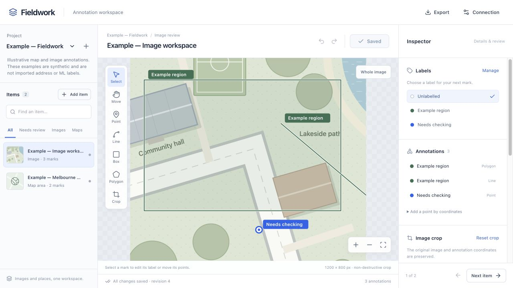
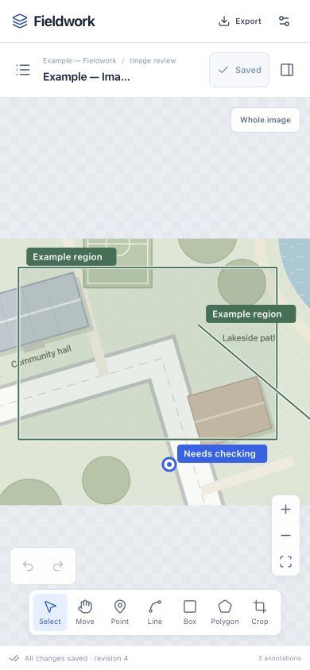

# Fieldwork handover

Fieldwork is deployed at **https://fieldwork-annotations.ben-ebsworth.workers.dev**.
The React/Tailwind workspace runs on Cloudflare; its Go Connect service runs in
Cloudflare Containers and stores canonical documents and change history in Neon
PostgreSQL. The database is in Sydney. Cloudflare uses automatic container
placement because its Oceania-only placement was unavailable at launch.

## Mooroolbark data validation

Mooroolbark is uploaded to the live app: 506 scenes, 43,316 editable objects,
10 labels and the canonical 10,339-roof report. All 518 projected documents match
the frozen source through the production CLI mirror. The initial sync ends at
cursor `535`; repeating it applies zero changes.
A fresh cloud download restored all 14,330 source files with exact hashes,
lengths and timestamps. The restored reader reproduces the canonical inventory.
See the [parity report](mooroolbark-parity.md) for the full evidence and scope.
The dataset report opens first; its roof map links to exact
source objects. Scenes expose imagery, 3D roofs, roof lines, prediction/review
comparisons, history and retained analysis. New edits remain separate from the
immutable source and its original training flags.

The item queue shows the number loaded so far. Search covers the entire project;
the review/type filters apply to loaded items. Use **Load more items** to browse
subsequent pages. Image scenes show their capture IDs so repeated addresses can
be distinguished.

The complete data download uses the new migration CLI:

```sh
go build -o bin/annotation-migrate ./cmd/annotation-migrate
bin/annotation-migrate pull --project mooroolbark \
  --url https://fieldwork-annotations.ben-ebsworth.workers.dev \
  --token-file deploy/annotation/admin-token.txt \
  --output /private/tmp/mooroolbark-download
bin/annotation-migrate restore --bundle /private/tmp/mooroolbark-download \
  --output /private/tmp/mooroolbark-restored
PYTHONDONTWRITEBYTECODE=1 scripts/ml/.venv/bin/python \
  scripts/verify_annotation_restore.py /private/tmp/mooroolbark-restored
```

Use new output directories; existing destinations are refused. The download
contains original files, current editable documents, full change history and
protected assets referenced by later edits. Browser export contains editable
documents only. Neither export rewrites local ML review files automatically.

## Start your final validation

1. Open the live app, choose **Connection**, leave Server URL empty, and enter
   the token from `deploy/annotation/admin-token.txt`, then choose **Connect**.
   The token stays in the
   browser tab session. It is not embedded in the app or shown in these docs.
2. Choose **Mooroolbark**. The first item is **Mooroolbark · Local dataset and
   analysis**. Confirm the overview shows 10,339 roofs and 257 completed tiles.
3. Open **Roof map**, filter the evidence bands and choose a roof, then
   **Open exact object**. Its scene, object ID and source review remain linked.
4. Search the queue for **24 CAMBRIDGE**, then inspect **Image**, **3D**,
   **Roof lines**, **Analysis** and **History**. Select an object to see its
   source state and editable feedback. Imported-object API edits follow the
   [adapter contract](addr-scene-api.md).
5. On your phone, open the queue and inspector from the header. Object status
   and notes appear first; add a short note and choose the persistent
   **Save changes** button at the bottom of the inspector. Confirm the saved
   revision. Reopen the item and run the sync
   command below to retrieve the new revision. New feedback stays separate
   from the frozen source and its training flags.

For generic drawing and cropping, use **Example — Fieldwork**: its image and
annotations are synthetic practice data. Try point, line, box and polygon tools,
label management, notes, tags, crop and undo/redo. Lines and polygons use
**Finish**; crop retains original image coordinates. New projects can contain
global map areas (**Use this view**) and image items from direct image URLs.

A conflicting save retains your draft. Download it before loading the latest
server copy and reconciling your changes. Recovery copies are local to the
device and API origin; they are not background synchronisation. Changing an
approved item's annotations or crop returns it to **In review**. Changing only
its notes or tags retains its current status.

## Pull updated data

A local binary is available at `bin/annotate`. Rebuild it with:

```sh
go build -o bin/annotate ./cmd/annotate
```

For regular feedback retrieval, run the same command whenever you want updates:

```sh
bin/annotate sync --project mooroolbark --dir data/fieldwork-sync/mooroolbark \
  --url https://fieldwork-annotations.ben-ebsworth.workers.dev \
  --token-file deploy/annotation/admin-token.txt
```

The first run builds `mirror.json`; later runs fetch changes after its saved
cursor, including deletions. Documents and cursor publish together, and a failed
run preserves the previous mirror. Local mirror edits are not pushed. Use
revision-checked CLI, API or MCP writes to submit feedback. Source images and the
frozen local archive use `annotation-migrate pull` above.

See the [sync guide](sync.md) for MCP write tools, API examples and recovery.

These examples run from the repository root and read the token from its file:

```sh
bin/annotate projects \
  --url https://fieldwork-annotations.ben-ebsworth.workers.dev \
  --token-file deploy/annotation/admin-token.txt

bin/annotate changes --project example-fieldwork --after 0 \
  --url https://fieldwork-annotations.ben-ebsworth.workers.dev \
  --token-file deploy/annotation/admin-token.txt

bin/annotate export --project example-fieldwork --format ndjson \
  --url https://fieldwork-annotations.ben-ebsworth.workers.dev \
  --token-file deploy/annotation/admin-token.txt > fieldwork-export.ndjson
```

For changes, store `nextCursor` and keep requesting pages while `hasMore` is
true. Project, item and label lists continue until `nextCursor` is empty. A full
export supplies a consistent snapshot and cursor from which to resume changes.
Import is create-only and stops on conflicts; it does not overwrite documents.
Use `bin/annotate help` for revision-safe writes and JSON import commands.

MCP clients can launch the local stdio bridge without exposing a token in their
configuration:

```json
{
  "mcpServers": {
    "fieldwork": {
      "command": "/Users/benebsworth/projects/addr/bin/annotate",
      "args": [
        "mcp",
        "--url", "https://fieldwork-annotations.ben-ebsworth.workers.dev",
        "--token-file", "/Users/benebsworth/projects/addr/deploy/annotation/admin-token.txt"
      ]
    }
  }
}
```

MCP provides discovery, project/item/label reads, change-feed and export tools,
plus revision-checked document and annotation writes. REST lives at `/api/v1/`,
Connect at `/annotation.v1.AnnotationService/`, and HTTP MCP at `/mcp`.
All data endpoints require the bearer token. See the full contract in
[`internal/annotation/README.md`](../../internal/annotation/README.md).

## Extend or run locally

- Frontend adapter registry: `src/lib/annotations/adapters.ts`. Register an
  editor, source fields and source constructor without changing the workspace.
- Go adapter interface: `internal/annotation/adapters.go`. Supply validators
  through `WithAdapters` at startup; persistence, revisions and exports remain
  shared. Register the same adapter ID on each side.
- Generic metadata and adapter source extensions are retained on save.
- The existing Next app has an `/annotations` source route. The cloud entry is
  `apps/annotation-web`; it shares the editor components and generated client.

```sh
go run ./cmd/annotation-server --dev \
  --sqlite /private/tmp/fieldwork-dev.db --listen 127.0.0.1:8095
# In another terminal:
pnpm dev:annotations
```

The preview is at `http://127.0.0.1:4173`. Explicit development mode accepts
loopback requests only. Cloud mode requires PostgreSQL and authentication.

## Verification completed

- Live phone → CLI sync: review notes saved at 390 px, survived reload, and
  produced exactly one incremental update. Live MCP label and line writes,
  direct REST feedback, rejected stale revisions, deletion replay and no-op
  resume also passed. The temporary records were removed; original example
  documents remained exactly unchanged. See
  [live sync evidence](live-sync-verification.json).
- Imported-scene API → browser: an object note appeared in the editor; clearing
  it preserved all roof parts, roof lines and the roof annotation. Invalid
  generic note/deletion/class-label mutations return actionable errors. See the
  [write contract](addr-scene-api.md) and
  [isolated scene proof](addr-scene-api-verification.json).
- Production: final frontend bundle, readiness, Neon-backed REST and Connect,
  MCP initialization, missing-token rejection and untrusted-origin rejection.
- Production database reliability: fixed a transaction-pool protocol failure;
  all 64 concurrent read checks now pass without retries. The isolated Neon
  integration also verifies JSON writes and revision conflicts. See the
  [deployment proof](mooroolbark-verification/production-protocol-fix-verification.json).
- Real Neon isolated-schema integration and Go race tests: persistence,
  conflicting writers, commit-ordered cursors, pagination and snapshot resume.
- Desktop browser: labelled line and review note saved and read through CLI;
  non-destructive crop, undo/redo and reload preserved the result.
- Phone browser at 390 px: drawing, undo/redo, label creation and assignment,
  review notes, tag normalization, geographic map saves and no horizontal
  overflow. Clean undo followed by reload no longer offers an abandoned draft.
- Root TypeScript check, focused ESLint with zero warnings, production Vite
  build, Go vet, scoped Buf lint and focused draft regression checks passed.
- Independent Astra review found null-coordinate validation and large MCP
  response handling defects. Both were fixed and regression-checked.

The full unrelated ML suite was not rerun. Production sign-in and live
browser/API/MCP/CLI feedback checks pass using the approved workspace token.
The Mooroolbark upload, repeat import, exact document mirror and no-op sync
checks passed. A complete fresh cloud download, file-by-file restoration,
independent history replay and restored analysis replay all passed; the
parity report links their machine-readable results.

The follow-up usability review corrected connection-required onboarding,
mobile save visibility, hidden object selection, capture identification and
image filtering. It also preserves exact API-authored polygon coordinates on
notes-only edits and includes later-added protected evidence when uploading a
downloaded backup. Original source predictions remain read-only.

The deployed phone check saved an object note on a clearly marked temporary
copy, reloaded it, and retrieved identical state through API, MCP and CLI.
All 90 geometries and the other 89 annotations were unchanged. The copy was
deleted afterward; all 507 original items, 10 labels and the project remain
identical. The audit retains the test create/update/delete at cursors 536–538;
the current CLI mirror is at `538`. Desktop 1280 × 800 and phone 390 × 844
browser checks passed without app console errors or horizontal overflow.
Physical-phone keyboards and offline editing were not tested in this review.

## Current boundaries

This first release uses one shared administrator token across projects. It does
not yet provide individual accounts or per-project roles. Generic image items
take URLs; phone file upload is not included. Imported datasets use immutable,
authenticated Cloudflare R2 assets. Source ML jobs remain local, and importing
does not grant training eligibility. New hole drawing and roof XY graph editing
remain in the source application; existing holes and roof linework are preserved.

Source images should have stable URLs. A save cannot change an image item's
source URL or declared dimensions; create a new item for a different image.
This does not prevent an external host from replacing content behind a URL.

Deployment commands, resources, operations and credential handling are in
[`docs/annotation-deployment.md`](../annotation-deployment.md). The rollout
uses idle suspension and disposable container disk; durable data is in Neon.

The visual concept used the built-in imagegen tool. Its saved output is
[`fieldwork-concept.png`](fieldwork-concept.png), with the complete final prompt
in [`imagegen-prompt.txt`](imagegen-prompt.txt). It is a design mockup; verification
screenshots below show the implemented generic editor using synthetic practice
data. Live Mooroolbark evidence is linked from the parity report.

### Implemented editor

These screenshots use the local verification workspace. Its saved annotations
include the drawing, labels, crop and notes checked during browser testing.




