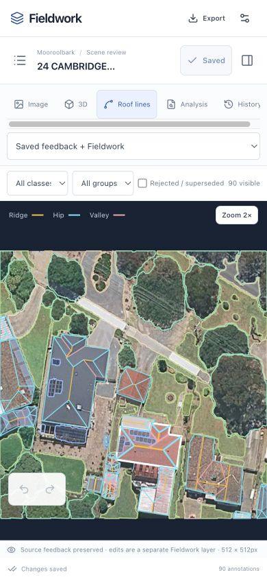
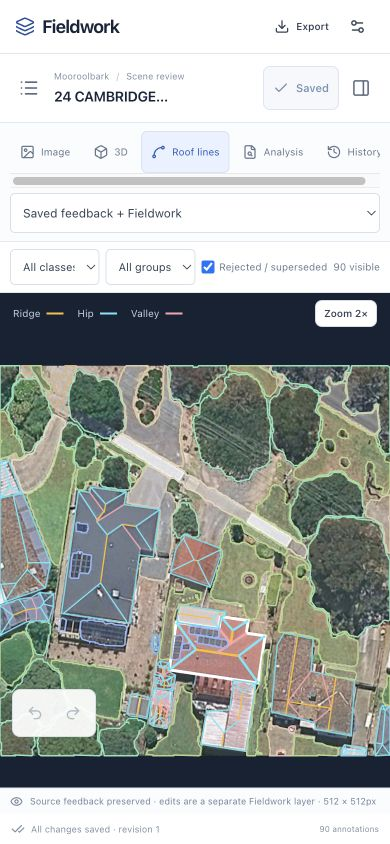

# Mooroolbark import and parity report

The Mooroolbark dataset is uploaded and verified through the live Cloudflare
application, Neon database and private R2 assets. A fresh cloud download restores
all 14,330 source files exactly, and its reader reproduces the local processing
inventory. Document, history, browser and incremental sync checks also pass.

## Frozen source

Snapshot: `6d8811d04524eeb196c654ac3647fb32f11d14813f4ff58eb1fb5a747f238572`.

The bundle is in `data/annotation-snapshots/mooroolbark-23591d058ab7/`:

- `manifest.json` maps original paths to complete-file and ordered chunk hashes.
- `blobs/` contains immutable content-addressed data, at most 64 MiB per blob.
- `source/` reproduces the source tree with original file timestamps.
- `local-verification.json` records the independent reconstruction results.

The snapshot contains **14,330 files**, **5,618,694,792 logical bytes**, and
**10,026 unique blobs** occupying **3,725,222,450 bytes**. Every file reconstructed
from its chunks matches its complete SHA-256 and byte length. SQLite databases
were backed up consistently, including committed WAL data; copied databases
passed integrity checks.

The snapshot was finalized at **2026-09-27 02:49:07 UTC**, including the latest
optical-analysis review page and the reader's Python dependencies. Earlier
manifests remain under `history/`. At **2026-09-27 02:50:08 UTC**, the final
source-scope check found no new or changed source files in the selected data
roots. File timestamps are retained in the
manifest because the local confidence reader uses them to check model freshness.

## Scope and preserved state

All **506 current image frames intersecting the official Mooroolbark boundary**
are included, comprising the 257 suburb tiles and earlier house, map and training
captures. The scene source contains 43,297 model objects, 143 current reviews,
12,124 reviewed-scene objects, 74 historical review revisions, 540 immutable model
snapshots and 507 scene images. The importer preserves complete frames and holes,
source IDs, coordinate transforms, parent/group links, replacement lineage,
roof geometry, feedback bindings, visibility and provenance.

Current reviews contain 296 confirmed objects, 90 needing adjustment, 120
rejected, 35 superseded and 11,583 candidates. Of the review files, 74 were saved
by `machine:decision-policy-v2` and 69 by `local`. These identities do not establish
human authorship. Among the 296 confirmed objects, 97 retain explicit machine
provenance. Existing flags are preserved; importing creates no new training
approval or verified height claims.

The archive also preserves connected diagnostics, confidence and calibration,
checkpoints, address evidence, CRM annotations, references, training/evaluation
artifacts, experiments, self-reviews, source code and legacy vector overlays.
Mixed-area training artifacts retain their original context and split identity.

## Canonical local comparison — passed

The existing `scene_processing.inventory` implementation was run against both
the frozen tree and the live local data. Their canonical JSON is equal after
excluding only the request-time `fetched_at` field. This compares geometry and
per-roof properties as well as totals.

| Measure | Local | Frozen copy |
| --- | ---: | ---: |
| Official suburb roof inventory | 10,339 | 10,339 |
| Low evidence | 1,892 | 1,892 |
| Mixed evidence | 8,416 | 8,416 |
| Stronger evidence | 31 | 31 |
| Scan tiles | 257 | 257 |
| Scan-owned buildings | 10,072 | 10,072 |
| Scan-owned trees | 7,874 | 7,874 |
| Scan-owned solar arrays | 2,163 | 2,163 |
| Matched property addresses | 8,161 | 8,161 |
| Ambiguous property addresses | 1,985 | 1,985 |
| Shared property addresses | 187 | 187 |
| Explicitly linked property addresses | 1 | 1 |
| Unmatched property addresses | 5 | 5 |

The confidence index has 10,531 rows before display suppression and suburb
filtering. The map bounding box includes neighbouring context. These quantities
must not be presented as the same denominator. Calibration has zero eligible
fully reviewed validation building layers; evidence bands are not probabilities.

The restored reader produces canonical SHA-256
`c4aaba2ae3e11c9e1a612cf196aa8287cf653fe0d0050976a56ec373bfc1b41e`.
The snapshot builder now runs the copied reader and its copied dependencies in a
separate process before publishing a manifest. This caught and fixed an overly
broad filename exclusion that omitted `scripts/ml/annotation_check.py`.

## Import and retrieval contract

The editable projection contains 506 scenes and 43,316 objects: current saved
reviews where present, otherwise the original model. It differs from the
43,297-object immutable model population because saved reviews retain edited
and replacement objects. Each polygon retains its original rings, including
4,416 interior rings. The 507th item is the dataset report. Ten labels and one
project bring the total to 518 documents.

The import is create-only, skips identical records on retry, and refuses to
overwrite differing records. Source actors, statuses and training flags remain
unaltered. Raw files are immutable protected assets; new feedback is a separate
revisioned Fieldwork layer.

`annotation-migrate pull` downloads the frozen archive, current documents and
the full change feed at a returned cursor. It also downloads protected assets
referenced by later revisions, including subsequently removed evidence. The
asset catalog is `fieldwork-assets.json`; editable state and history are
`fieldwork-state.ndjson` and `fieldwork-changes.ndjson`. Restore reconstructs the
original snapshot paths and timestamps. Later Fieldwork edits remain explicitly
separate; they are not silently written into the local training review files.

The browser's large export uses a cursor-consistent change-feed replay because
the complete editable dataset exceeds the single-request 32 MiB limit. Use the
migration CLI to include source images, analysis and database files as well.

## Explicit exclusions

The approximately 25.5 GB disposable imagery cache is excluded. All imagery
referenced by the selected scenes and frozen suburb run is preserved. The 56
current scene frames outside the suburb are listed in the manifest; connected
cross-area training and evaluation artifacts remain in the supporting archive.

CRM authentication/identity tables are removed from a copied database, followed
by secure deletion and compaction. The three unrelated Croydon/Kilsyth CRM
features are excluded; the source database is unchanged. General geographic
context remains in the snapshot, while editable CRM data is scoped to Mooroolbark.

Process IDs, locks, incomplete writes, bytecode, dependency installations,
downloaded inference weights and machine credentials are not migrated. This
reproduces stored data and analysis; it does not rerun or deploy local ML jobs.

## Full local import and round trip — passed

The loaded validation workspace is running at **http://127.0.0.1:8096/**.

The isolated Go service imported all 518 documents. An identical second import
created no documents or history entries and uploaded no assets. Independent
enumeration and GET verification confirmed the exact project, label and item
sets, including the absence of extra documents. All 43,316 object projections
match the frozen source, including classes, statuses, provenance and interior
rings. No source review was promoted to Fieldwork approval.

The CLI downloaded all **10,027 protected blobs**, including the manifest, and
verified their hashes. It preserved 518 pristine documents and 518 create
events at cursor `518`. Restoring this downloaded bundle reconstructed all
14,330 paths with exact complete-file hashes, lengths and nanosecond timestamps;
there were no missing files, extra files or symlinks.

Evidence: [independent document comparison](mooroolbark-verification/http-semantic-verification.json),
[repeat import](mooroolbark-verification/reimport-summary.json),
[download](mooroolbark-verification/pull-summary.json),
[state and history](mooroolbark-verification/state-history-verification.json),
[restored file hashes and timestamps](mooroolbark-verification/restore-file-verification.json),
and [restored analysis](mooroolbark-restored-analysis.json).

## Browser feedback — passed

Desktop and 390 × 844 phone checks cover the canonical report, roof evidence
filters, exact-object navigation, server-side scene search, archived review
inspection, imagery, roof lines, 3D and the searchable source archive. The
phone layout has no document-level horizontal overflow. Large-project browser
export completes through the paginated fallback.

A phone save on `house-30296` added a marked verification note to one object and
the scene. Reading revision 2 through the Go CLI confirmed all 90 annotation
geometries, immutable source references, metadata, tags and status were
unchanged. The other 89 objects were identical; the selected object had only a
`notes` override and no removed source fields. This verification edit is in the
isolated test database. A full browser reload retained the saved notes and source
roof details. The frozen bundle remains unchanged.

The real-data test caught a JSON-key-order comparison that invalidated roof
details on a notes-only edit; semantic geometry comparison now prevents it.
Independent review also fixed connection changes during paginated export and
missing later asset references during a full pull. Focused regressions cover
these cases. TypeScript, scoped lint, frontend build, Go tests/vet and the
Worker asset tests passed; the unrelated ML suite was not rerun.

Evidence: [browser-to-CLI comparison](mooroolbark-browser-save.json).

## Cloud upload, restoration and incremental sync — passed

The application update is deployed at
**https://fieldwork-annotations.ben-ebsworth.workers.dev** with private R2 asset
support and the rich scene/report adapters. Initial parity was checked on Worker
`eb12acbb-bb33-4a0e-9f53-d86f42381243`, frontend `index-C_l181Xb.js`.
The subsequent usability update is Worker `65420db2-d760-4d6b-a930-49865dce4281`,
frontend `index-CHuhBMYV.js`; the frozen source is unchanged.
Its phone save/reload and API/MCP/CLI check used a temporary scene copy, then
deleted that copy. All 518 original documents remain identical; the three
marked verification audit events advance the current mirror to cursor `538`.
The initial import and full-restore evidence below remains at cursor `535`.
Public checks verified the current frontend
bundle, healthy database readiness, anonymous asset rejection and untrusted
origin rejection. See [final server deployment](mooroolbark-verification/production-protocol-fix-verification.json),
[UI deployment](mooroolbark-verification/production-final-ui-deployment.json),
[asset deployment evidence](mooroolbark-verification/production-deployment.json)
and the earlier [asset-route checks](mooroolbark-verification/deployment-verification.json).

The user approved the live upload and credential use on 2026-09-27. The frozen
bundle is uploaded: all 10,027 protected assets, including the manifest, and all
518 documents. The resumed final pass uploaded 20 missing assets and reused
10,007 already uploaded hashes; all 518 documents were created once.
See [production import](mooroolbark-verification/production-import-summary.json).
An identical production reimport created no documents and uploaded no assets;
see [repeat import](mooroolbark-verification/production-reimport-summary.json).
The migration verifier also confirmed all 518 documents and the digest/size
metadata of all 10,027 remote assets; see
[production verification](mooroolbark-verification/production-verify-summary.json).

The production CLI mirror contains exactly 507 items, 10 labels and 43,316
annotations. Every projected document matches the frozen plan, excluding only
server revision/timestamps; all initial revisions are 1. It replays 518 create
events through global cursor `535`. The cursor includes gaps from other
projects, so it is not the project event count. A second sync returns zero
changes and does not replace the mirror.
See [production incremental sync](mooroolbark-verification/production-incremental-sync.json).
Independent HTTP enumeration and all 507 item reads also match the frozen plan,
including all 4,416 interior rings, statuses and provenance. Existing example
projects remain unchanged. See the
[semantic comparison](mooroolbark-verification/production-http-semantic-verification.json).

The live phone UI opens the overview with 10,339 roofs and 257 completed tiles.
Its protected roof map shows the expected evidence bands and navigates to the
exact source object. The Cambridge Road scene retains its 90 annotations,
source review revision 3, eight roof parts and twelve roof lines. These checks
made no edits to Mooroolbark.
See [live browser evidence](mooroolbark-production-browser.json).

A fresh cloud download fetched and hash-verified all **10,027 assets** without
reusing local blobs. Restoring it recovered all **14,330 paths** and
**5,618,694,792 logical bytes**, with exact SHA-256, lengths and nanosecond
timestamps and no missing or extra files. Its 518 initial create events replay
to exactly the downloaded documents at cursor `535`. The restored source reader
reproduces the complete canonical JSON and SHA-256 above, including 10,339 roofs,
257 tiles and all address/evidence counts.

Evidence: [cloud download](mooroolbark-verification/production-pull-summary.json),
[restore](mooroolbark-verification/production-restore-summary.json),
[independent file checks](mooroolbark-verification/production-restore-file-verification.json),
[history replay](mooroolbark-verification/production-state-history-verification.json),
and [restored analysis](mooroolbark-verification/production-restored-analysis.json).

Verification exposed intermittent Neon transaction-pool read failures: lib/pq
split preparation and parameter binding across protocol exchanges, allowing an
unnamed prepared statement to change between them. The driver now uses its
single-exchange parameter mode. The same production check improved from 13
failures in 64 reads to **64/64 successes with zero retries**, at concurrency 8.
An isolated Neon integration verifies writes, revision conflicts and persistence.
No production document or schema changes were needed for this fix. See the
[diagnosis](mooroolbark-verification/production-read-error-diagnosis.json),
[final production check](mooroolbark-verification/production-protocol-fix-verification.json)
and [local pooled-read comparison](mooroolbark-verification/neon-pool-fix-proof.json).

The reviewed commands and client contract are in
[the backend README](../../internal/annotation/README.md).

The full [inventory](mooroolbark-inventory.md) and its
[machine-readable record](mooroolbark-inventory.json) provide per-scene details.
The snapshot builder is `scripts/annotation_snapshot.py`.
